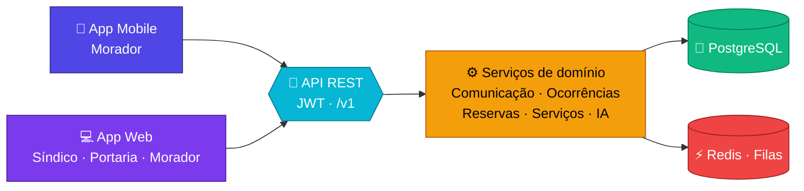

<div align="center">


<br/>


**[Sobre](#-sobre-o-projeto) · [Funcionalidades](#-funcionalidades) · [Diferencial](#-nosso-diferencial) · [Arquitetura](#-arquitetura) · [Como rodar](#-como-rodar-o-protótipo) · [Estrutura](#-estrutura-do-repositório) · [Equipe](#-equipe)**

</div>

---

## 🏢 Sobre o projeto

O **Zeluvi** é uma plataforma de **gestão condominial** (web e mobile) que reúne em um só lugar a comunicação, as ocorrências, as reservas e as encomendas de um condomínio.

Hoje, boa parte disso acontece em grupos de WhatsApp: avisos que se perdem, problemas sem acompanhamento e reservas combinadas na base da conversa. O Zeluvi organiza tudo isso, com telas feitas para **qualquer pessoa usar**, com letra grande, contraste alto e botões fáceis de tocar.

> 💡 **Ideia central:** transformar o dia a dia do condomínio em algo **organizado, rastreável e transparente** para moradores, síndico e portaria.

---

## 👥 Para quem é

<table>
  <tr>
    <td align="center" width="33%">
      <h3>🏠 Morador</h3>
      Registra ocorrências, recebe comunicados, faz reservas, avisa mudanças e acompanha cada solicitação.
    </td>
    <td align="center" width="33%">
      <h3>🧑‍💼 Síndico / Administração</h3>
      Gerencia ocorrências e reservas, envia comunicados e administra o cadastro de moradores.
    </td>
    <td align="center" width="33%">
      <h3>🛎️ Portaria</h3>
      Controla recebimento e entrega de encomendas, registra mudanças e acompanha as ocorrências relevantes.
    </td>
  </tr>
</table>

---

## ✨ Funcionalidades

| | Módulo | O que faz |
|:-:|---|---|
| 📣 | **Comunicação** | Comunicados da administração, notificações e canal direto entre moradores e síndico |
| 🛠️ | **Ocorrências** | Relato de problemas (manutenção, limpeza, elevador, iluminação) com status e histórico em linha do tempo |
| 📅 | **Reservas** | Salão de festas, churrasqueira, espaço gourmet e elevador de serviço, com regras e antecedência mínima |
| 📦 | **Encomendas** | Gestão de entregas e encomendas feita pela portaria |
| 🤝 | **Serviços** | Profissionais indicados e avaliados pelos próprios moradores |
| 🤖 | **Inteligência artificial** | Copiloto do Síndico, automações, painel executivo e assembleias digitais com transcrição |

---

## 🌟 Nosso diferencial

### Serviços indicados pela comunidade

Quem nunca viu no grupo do condomínio: *"Alguém conhece um eletricista?"*

As indicações ficam espalhadas, perdidas entre mensagens antigas, sem informação de preço ou qualidade. No Zeluvi, o morador escolhe o serviço que precisa (elétrica, hidráulica, pintura, máquina de lavar...) e vê **profissionais já usados por vizinhos**, com contato direto e avaliações.

> **Rodrigo** — ⭐⭐⭐⭐⭐
> *"Profissional confiável, realizou o serviço corretamente e cobrou R$ 100."*

Assim, a recomendação informal vira uma **rede organizada de confiança**, e bons profissionais constroem reputação dentro da própria comunidade.

> 📖 Mais detalhes em [`docs/02-pesquisa/Diferencial.md`](docs/02-pesquisa/Diferencial.md)

---

## 🧱 Arquitetura



- **Monólito modular e stateless**, com uma única API REST consumida por web e mobile
- **Multi-tenant por condomínio:** cada dado carrega o identificador do condomínio
- **Camadas no backend:** Rota → Middlewares → Controller → Service → Repository → Prisma → PostgreSQL
- **Acessibilidade por padrão:** letra grande, contraste alto e alvos de toque de 56 px

> 📖 Detalhes em [`docs/05-arquitetura/`](docs/05-arquitetura/)

---

## 🚀 Como rodar o protótipo

O protótipo do front-end é uma página estática (HTML, CSS e React carregado por CDN), então **não precisa instalar dependências**.

```bash
# 1. Clone o repositório
git clone https://github.com/andregarciaaaaa/ZELUVII.git
cd ZELUVII

# 2. Sirva a pasta src (escolha uma das opções)
npx serve src
# ou
python -m http.server 8000 --directory src
```

Depois, abra no navegador o endereço que aparecer (por exemplo `http://localhost:3000` ou `http://localhost:8000`).

> ⚠️ É preciso estar **conectado à internet**: React, fontes e o visualizador 3D são carregados por CDN.

---

## 🗂️ Estrutura do repositório

```text
ZELUVII/
├── 📄 README.md
├── 🖼️ assets/
│   └── logo/                  # Logotipos do projeto
├── 💻 src/                    # Protótipo do front-end
│   ├── index.html
│   ├── css/
│   ├── js/
│   └── assets/                # Vídeo e modelo 3D do prédio
└── 📚 docs/
    ├── 01-planejamento/       # Escopo, RACI, SWOT, GUT, Diamante Duplo
    ├── 02-pesquisa/           # Pesquisa de mercado, CDC, LGPD, diferencial
    ├── 03-dominio-e-marca/    # Domínio (GoDaddy, Registro.br) e registro no INPI
    ├── 04-modelagem/          # Casos de uso, classes, DER e sequência
    ├── 05-arquitetura/        # Definição arquitetural, system design, escalabilidade
    ├── 06-qualidade/          # Definition of Done, processo e plano de testes de QA
    ├── 07-sprints/            # Entregas por fase e sprint
    └── prototipos/            # Protótipos de tela
```

---

## 📚 Documentação

| 📁 Pasta | 📝 Conteúdo |
|---|---|
| [`01-planejamento`](docs/01-planejamento/) | Escopo do projeto, matriz RACI, SWOT, matriz GUT, Modelo Diamante Duplo |
| [`02-pesquisa`](docs/02-pesquisa/) | Pesquisa de mercado, CDC, LGPD e diferencial |
| [`03-dominio-e-marca`](docs/03-dominio-e-marca/) | Estratégia de domínio e registro da marca |
| [`04-modelagem`](docs/04-modelagem/) | Diagramas de caso de uso, classes, DER e sequência |
| [`05-arquitetura`](docs/05-arquitetura/) | Arquitetura, system design e escalabilidade |
| [`06-qualidade`](docs/06-qualidade/) | Definition of Done e plano de testes |
| [`07-sprints`](docs/07-sprints/) | Entregas de cada fase e sprint |
| [`prototipos`](docs/prototipos/) | Protótipos de login, recuperação de senha e dashboard |

---

## 🛣️ Roadmap

- [x] Planejamento e escopo
- [x] Modelagem (casos de uso, classes, DER)
- [x] Definição de arquitetura
- [x] Protótipo do front-end
- [x] Especificação das APIs de autenticação e moradores
- [ ] Backend (API REST + banco de dados)
- [ ] Integração do front-end com a API
- [ ] Aplicativo mobile
- [ ] Módulos de inteligência artificial

---

## 🤝 Equipe

Projeto desenvolvido em grupo, como trabalho acadêmico.

<a href="https://github.com/andregarciaaaaa/ZELUVII/graphs/contributors">
  
</a>

---

<div align="center">

Feito com 💜 por estudantes de Análise e Desenvolvimento de Sistemas


</div>
